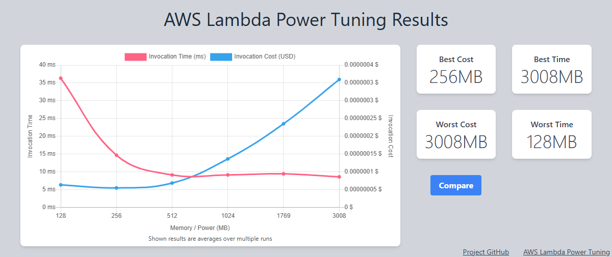

# Serverless Orders Application (AWS SAM)

An orders backend built entirely on AWS serverless services and defined as code in a single
[AWS SAM](https://docs.aws.amazon.com/serverless-application-model/) template. The project is built
incrementally, one exercise at a time — each phase extends the same `template.yaml` and is deployed
as an update to one CloudFormation stack (`orders-serverless-app`).

| | |
|---|---|
| **IaC** | AWS SAM (CloudFormation transform) — one template, one stack |
| **Runtime** | Python 3.12 on arm64 (Graviton) |
| **Regions** | us-east-1 (primary), us-west-2 (DR replica — planned) |

## Progress

| # | Exercise | Services | Status |
|---|---|---|---|
| 1 | NoSQL database | DynamoDB | ✅ Done |
| 2 | Order logic | Lambda, IAM | ✅ Done |
| 3 | REST API | API Gateway | ✅ Done |
| 4 | Security | Cognito, WAF | ✅ Done |
| 5 | Monitoring | CloudWatch, X-Ray | ✅ Done |
| 6 | CI/CD | GitHub Actions (OIDC) | ✅ Done |
| 7 | Local development | SAM CLI, DynamoDB Local | ⏸ Tooling ready, local run pending (Docker issue) |
| 8 | Lambda optimization | Lambda, Power Tuning | ✅ Done |
| 9 | Direct integration | API Gateway → DynamoDB | ✅ Done |
| 10 | Caching | DAX, API Gateway cache | 🟡 Built, DAX verified; API cache test pending |
| 11 | Disaster recovery | DynamoDB Global Tables | ⬜ |
| 12 | Cost estimate | AWS Pricing Calculator | ⬜ |
| 13 | Analytics API | DynamoDB Streams, Lambda | ⬜ |

## Architecture (current)

```
                    ┌──────────────────────┐
                    │ Cognito User Pool    │ 1. sign in → ID token (JWT)
          ┌────────►│ admin-created users  │
          │         └──────────┬───────────┘
          │                    │ validates JWT
  client ─┴──► ┌─────────┐   ┌─▼──────────────────────┐      ┌────────────────────────────┐      ┌──────────────────────────┐
  HTTPS        │ AWS WAF │──►│ API Gateway (REST)     │─────►│ Lambda: CreateOrder        │─────►│ DynamoDB: Orders         │
  Authorization│ 100 req/│   │ stage: prod · REGIONAL │proxy │ python3.12 / arm64 / 512MB │batch │ PK orderId · SK itemId   │
  : <IdToken>  │ 5min/IP │   │ POST /orders           │      │ IAM: DynamoDBWritePolicy   │write │ on-demand · SSE · PITR   │
               │ → 429   │   │ GET /direct/orders/{id}│      └────────────────────────────┘      └─────────────▲────────────┘
               └─────────┘   │ Cognito authorizer     │                                                        │
                             │ throttle 100 rps/50 burst ──── direct "AWS" integration: dynamodb:Query ───────┘
                             └────────────────────────┘     (role ApiDynamoDbReadRole, VTL mapping, no Lambda)
```

Request paths:

- **Create** — **WAF** (rate limit per IP) → **API Gateway** (Cognito authorizer checks the JWT) →
  **Lambda** (validates payload, reads `sub` claim as `customerId`) → **DynamoDB** `BatchWriteItem`.
- **Read** — **WAF** → **API Gateway** (Cognito authorizer) → **DynamoDB** `Query` directly; a
  request mapping template builds the query (filtered to the caller's `sub`) and a response
  mapping template turns DynamoDB JSON into plain JSON. No Lambda involved.

**Observability:** X-Ray active tracing on the API stage and the Lambda function (one trace spans
API Gateway → Lambda → DynamoDB), structured JSON logs via Powertools, and a CloudWatch dashboard
(`orders-serverless-app-dashboard`) with:

| Widget | Metrics |
|---|---|
| API Gateway | `Count`, `4XXError`, `5XXError` (stage `prod`) |
| Lambda CreateOrder | `Invocations`, `Errors`, `Throttles` |
| Latency | API Gateway `Latency` / `IntegrationLatency` and Lambda `Duration` (p90) |
| WAF | `AllowedRequests` vs `BlockedRequests` for `RateLimitPerIP` |

## Data model

One DynamoDB item per order line, so an order with N products is N items sharing the same `orderId`.

| Attribute | Type | Notes |
|---|---|---|
| `orderId` | S (partition key) | UUID v4 generated by the Lambda |
| `itemId` | S (sort key) | Product/SKU id, unique within an order |
| `productName` | S | |
| `quantity` | N | Positive integer |
| `unitPrice` | N | Stored as `Decimal` |
| `customerId` | S | Cognito `sub` claim of the caller (`anonymous` for orders created before exercise 4) |
| `status` | S | `CREATED` |
| `createdAt` | S | ISO-8601 UTC timestamp |

Fetching a whole order is a single `Query` on `orderId`; a single line is a `GetItem` on `orderId` + `itemId`.

## Repository layout

```
template.yaml                 SAM template (all application infrastructure)
samconfig.toml                Deploy config: "default" env (local, pinned profile) and "ci" env
env.json                      Environment overrides for sam local
scripts/local-setup.sh        DynamoDB Local in Docker for sam local
scripts/measure_cold_start.sh Forces N cold starts and reports Init Duration
events/power_tuning_input.json Lambda Power Tuning execution input
src/create_order/app.py       CreateOrder Lambda handler
events/create_order.json      Sample API Gateway-style event
tests/unit/                   pytest + moto unit tests
requirements-dev.txt          Test dependencies
infra/github-oidc.yaml        One-time CI/CD bootstrap (OIDC provider + IAM roles)
.github/workflows/deploy.yml  GitHub Actions: test → deploy → smoke test
```

## Getting started

**Prerequisites:** AWS CLI v2 (configured profile), AWS SAM CLI, Python 3.12.

```bash
# Run unit tests
python -m venv .venv
.venv/Scripts/python -m pip install -r requirements-dev.txt   # Windows (use .venv/bin on macOS/Linux)
.venv/Scripts/python -m pytest -q

# Build and deploy (settings come from samconfig.toml)
sam validate --lint
sam build
sam deploy

# Invoke the deployed function directly
sam remote invoke CreateOrderFunction --stack-name orders-serverless-app \
  --event-file events/create_order.json

```

### Calling the secured API

Self sign-up is disabled, so create a user as an admin first (IDs come from the stack outputs
`UserPoolId` and `UserPoolClientId`):

```bash
aws cognito-idp admin-create-user --user-pool-id $USER_POOL_ID --username you@example.com \
  --user-attributes Name=email,Value=you@example.com Name=email_verified,Value=true \
  --message-action SUPPRESS
aws cognito-idp admin-set-user-password --user-pool-id $USER_POOL_ID --username you@example.com \
  --password '<strong-password>' --permanent

# Sign in and grab the ID token (valid 60 minutes)
TOKEN=$(aws cognito-idp initiate-auth --auth-flow USER_PASSWORD_AUTH --client-id $CLIENT_ID \
  --auth-parameters USERNAME=you@example.com,PASSWORD='<strong-password>' \
  --query AuthenticationResult.IdToken --output text)

# Call the API (ApiUrl is printed in the stack outputs)
curl -X POST "$API_URL/orders" -H "Authorization: $TOKEN" -H "Content-Type: application/json" \
  -d '{"items":[{"itemId":"SKU-3003","productName":"Mechanical Keyboard","quantity":1,"unitPrice":89.99}]}'
```

**Example request body** (`events/create_order.json` wraps this in an API Gateway event):

```json
{
  "items": [
    { "itemId": "SKU-1001", "productName": "Wireless Mouse", "quantity": 2, "unitPrice": 24.99 },
    { "itemId": "SKU-2002", "productName": "USB-C Hub", "quantity": 1, "unitPrice": 49.50 }
  ]
}
```

| Response | When |
|---|---|
| `201 {"orderId", "itemCount", "total"}` | Order saved |
| `400 {"message"}` | Invalid JSON, empty/oversized `items`, missing `itemId`, duplicate `itemId`, non-positive quantity, negative or non-numeric price |
| `401 {"message":"Unauthorized"}` | Missing, malformed or expired `Authorization` token (rejected by the Cognito authorizer — Lambda is never invoked) |
| `403 {"message":"Missing Authentication Token"}` | Route/method not defined — API Gateway's generic response for unknown routes |
| `429` | Client IP exceeded 100 requests in 5 minutes (blocked by WAF before reaching API Gateway) |

**Reading an order** (`GET /direct/orders/{orderId}`, served by API Gateway straight from DynamoDB):

```bash
curl "$API_URL/direct/orders/$ORDER_ID" -H "Authorization: $TOKEN"
```

```json
{
  "orderId": "d05749c5-3f20-451f-8db6-3c32852b8567",
  "itemCount": 2,
  "items": [
    { "itemId": "SKU-9001", "productName": "Desk Lamp", "quantity": 1, "unitPrice": 34.5,
      "status": "CREATED", "createdAt": "2026-10-18T09:41:58.794004+00:00" },
    { "itemId": "SKU-9002", "productName": "LED Bulb", "quantity": 4, "unitPrice": 3.25,
      "status": "CREATED", "createdAt": "2026-10-18T09:41:58.794004+00:00" }
  ]
}
```

| Response | When |
|---|---|
| `200` | The order exists **and belongs to the caller** |
| `404 {"message": "order not found"}` | Unknown `orderId`, *or* the order belongs to another user (indistinguishable on purpose) |
| `401` | No / invalid token |

### Local development (SAM CLI + DynamoDB Local)

Requires Docker. [`scripts/local-setup.sh`](scripts/local-setup.sh) starts DynamoDB Local on a
Docker network and creates an `orders-local` table; [`env.json`](env.json) points the function at it.

```bash
scripts/local-setup.sh                         # start DynamoDB Local + create table
sam build
sam local invoke CreateOrderFunction -e events/create_order.json --env-vars env.json --docker-network sam-local
sam local start-api --env-vars env.json --docker-network sam-local   # http://127.0.0.1:3000/orders
scripts/local-setup.sh down                    # clean up
```

Notes: `sam local` only overrides environment variables that are declared in the template (hence
the empty `DYNAMODB_ENDPOINT` on the function), it does **not** enforce the Cognito authorizer, and
on an x86 machine the arm64 function runs under QEMU emulation.

## CI/CD (GitHub Actions + OIDC)

[`.github/workflows/deploy.yml`](.github/workflows/deploy.yml) runs on every push to `main`
(pull requests run tests only):

```
push to main ──► test job ───────────────► deploy job ─────────────────────────────────────────────►
                 pytest (moto)              assume AWS role via OIDC → sam validate --lint →
                                            sam build → sam deploy → smoke test (no token ⇒ 401)
```

**No AWS keys are stored in GitHub.** The workflow requests a short-lived OIDC token from GitHub
and exchanges it for temporary AWS credentials. The trust is set up once with
[`infra/github-oidc.yaml`](infra/github-oidc.yaml), which creates:

| Resource | Purpose |
|---|---|
| GitHub OIDC identity provider | Lets AWS STS trust tokens issued by `token.actions.githubusercontent.com` |
| `aws-serverless-application-github-deploy` role | Assumed by the workflow. Trust is restricted to the `main` branch of this repository, pinned by GitHub's immutable owner/repo IDs (`repo:sriram-um@93265789/aws-serverless-application@1424159185:ref:refs/heads/main`), so other repos, forks, branches — or a re-created repo with the same name — cannot use it. It can only run change sets on this app's stack, upload to the SAM artifact bucket, and pass the execution role to CloudFormation. |
| `aws-serverless-application-cfn-execution` role | Assumed only by the CloudFormation service to create the actual resources (`sam deploy --role-arn`). |

This split (same pattern as `sam pipeline bootstrap`) means the credentials GitHub holds cannot
create resources directly — only CloudFormation can, and only through this stack's template.

**One-time setup:**

```bash
aws cloudformation deploy --template-file infra/github-oidc.yaml \
  --stack-name aws-serverless-application-github-oidc --capabilities CAPABILITY_NAMED_IAM
```

Then add two repository secrets (Settings → Secrets and variables → Actions) from that stack's
outputs: `AWS_DEPLOY_ROLE_ARN` and `AWS_CFN_EXECUTION_ROLE_ARN`.

**Traceable deployments.** The pipeline passes `AppVersion=${{ github.sha }}` to the stack; it is
set as the `APP_VERSION` environment variable and Powertools adds it to every log line as
`app_version`, so any log entry maps back to the exact commit that produced it.

**Verified run:** a code change pushed to `main` → tests (13 s) → OIDC role assumed → build →
deploy → smoke test, about 1 minute end to end. The Lambda's `CodeSha256` and `LastModified`
changed, and new log lines carried the pushed commit SHA. When nothing in the code changes, SAM
skips uploading the function (it compares content hashes), so documentation-only pushes deploy
in seconds without touching Lambda.

## Design decisions

- **One template, one stack.** Every exercise is an update to the same stack, so CloudFormation's
  change sets only add/modify what changed — earlier resources (and their data) are left untouched.
- **Least-privilege IAM.** The function uses SAM's `DynamoDBWritePolicy` policy template, scoped to
  the Orders table ARN only. It can write but not read or scan.
- **Lambda proxy integration.** API Gateway passes the full HTTP request to the function, which
  returns the status code, headers and body itself — routing logic stays in code, not mapping templates.
- **REGIONAL endpoint** rather than edge-optimized; WAF (exercise 4) and caching (exercise 10)
  attach directly to the regional stage, and a CDN can be put in front later if needed.
- **Stage throttling** (100 req/s steady, 50 burst) as a first guard against runaway clients and
  cost spikes, before WAF rate limiting is added.
- **Cognito authorizer as the API default.** Every route requires a valid ID token unless it opts
  out explicitly, so new routes are secure by default. Token checks happen in API Gateway, so
  unauthenticated traffic never invokes (or bills) the Lambda.
- **Admin-only user creation** (`AllowAdminCreateUserOnly`), a 12-character password policy with all
  character classes, `PreventUserExistenceErrors` (sign-in errors don't reveal whether an email is
  registered), and 60-minute ID/access tokens.
- **Identity from the token, not the body.** `customerId` comes from the verified `sub` claim, so a
  client cannot place orders on behalf of another user.
- **WAF rate-based rule** (100 requests / 5 min / IP) returning **429 Too Many Requests** instead of
  WAF's default 403, so clients can tell rate limiting apart from authorization failures.
- **Powertools for AWS Lambda (Python) as a pinned layer.** `Tracer` patches boto3 so every
  DynamoDB call becomes an X-Ray subsegment, and adds an `orderId` annotation so traces are
  searchable by order. `Logger` writes JSON logs with cold-start flag, request id, API Gateway
  correlation id and X-Ray trace id on every line. The layer version is a template parameter
  (`PowertoolsLayerArn`), so upgrades are deliberate, not silent; the latest ARN is published in SSM
  at `/aws/service/powertools/python/arm64/python3.12/latest`.
- **Dashboard as code.** The dashboard body is a `!Sub` JSON document in the template, so metric
  dimensions (API name, function name, WAF ACL) always match the deployed resources.
- **Direct integration for reads.** `GET /direct/orders/{orderId}` is an API Gateway `AWS`
  integration calling `dynamodb:Query` with its own role (`ApiDynamoDbReadRole`, `Query` on the
  Orders table only). Reads have no business logic, so a Lambda would only add cost, cold
  starts and code to maintain.
- **Ownership enforced in the query.** The request template adds
  `FilterExpression: customerId = :c` with `:c` = `$context.authorizer.claims.sub` (the verified
  token), so users can only read their own orders. Another user's order returns the same `404` as a
  non-existent one, which avoids leaking which order IDs exist.
- **Injection-safe mapping.** The path parameter is passed through `$util.escapeJavaScript(...)`
  before being placed into the JSON request, so a crafted `orderId` cannot break out of the string
  and alter the query (tested — returns 404).
- **Errors don't leak internals.** DynamoDB 4xx/5xx map to a generic `500 {"message": "internal error"}`;
  an empty result sets `$context.responseOverride.status = 404`.
- **Caching is a switch, not a fixture.** DAX, its VPC, the X-Ray interface endpoint and the API
  Gateway cache bill by the hour, so they exist only with `EnableCaching=true`
  (`sam deploy --parameter-overrides EnableCaching=true`). The same GetOrder code reads through
  DAX when `DAX_ENDPOINT` is set and straight from DynamoDB otherwise. The CI pipeline always
  deploys with the default (`false`), so a push also acts as a safety switch-off.
- **No NAT gateway for the DAX VPC.** The Lambda reaches DynamoDB through a free *gateway*
  endpoint and X-Ray through an *interface* endpoint; nothing else needs the internet.
- **DAX client as a lean layer.** `pip install amazon-dax-client` pulls ~26 MB of
  botocore/urllib3/dateutil the runtime already has (and shadows the runtime's botocore).
  `scripts/build_dax_layer.sh` installs only `amazondax` + `antlr4` with `--no-deps` into a
  1.4 MB layer; GetOrder's own package stays at ~5 KB.
- **Cache key includes the caller's token.** API Gateway caches by path parameters only unless
  told otherwise, which would serve user A's cached order to user B. Both GET routes add
  `method.request.header.Authorization` to `cacheKeyParameters`; cache entries are encrypted.
- **API defined in OpenAPI** (`DefinitionBody` inline in `template.yaml`) — required for non-Lambda
  integrations; both routes are declared there explicitly.
- **`OpenApiVersion: '3.0.1'`** on the API stops SAM from creating its extra default `Stage` stage,
  leaving only `prod`.
- **Explicit log group** with 14-day retention, instead of Lambda's default never-expire group.
- **arm64 (Graviton)** — roughly 20% cheaper per GB-second than x86 for the same workload.
- **Nothing bundled.** boto3 ships with the Lambda Python runtime, so the deployment package is
  just the handler file (a few KB), which keeps deploys and cold starts fast.
- **Validation before writes.** The whole payload is validated up front; nothing is written unless
  every line is valid. Writes use `batch_writer()`, which batches up to 25 items per request and
  retries unprocessed items.
- **`Decimal` for money.** boto3 rejects Python `float` for DynamoDB numbers; prices are parsed via
  `Decimal(str(value))` to avoid binary floating-point rounding (e.g. `24.99` stays `24.99`).

## Observations and lessons learned

### Lambda cold start vs. warm invocation

The first invocation after a deploy showed this in the `REPORT` log line:

```
Duration: 159.19 ms   Billed Duration: 577 ms   Memory Size: 256 MB   Max Memory Used: 96 MB   Init Duration: 417.04 ms
```

- **Init Duration (417 ms)** is the *cold start*: Lambda creating a new execution environment,
  starting the Python runtime and running the module-level code (importing boto3 and creating the
  DynamoDB resource). It only happens when a new environment is created — after a deploy, after
  idle time, or when scaling out to handle concurrent requests.
- **Duration (159 ms)** is the handler itself, including the first TLS connection to DynamoDB.
  Warm invocations reuse both the environment and the open connection, so they are much faster.
- **Billed Duration (577 ms)** ≈ init + duration. For managed runtimes like Python, init time on
  the first request is billed together with the invocation.
- **Max Memory Used (96 MB of 256 MB)** shows headroom; memory is right-sized later with Lambda
  Power Tuning (exercise 8). In Lambda, CPU scales with memory, so less memory is not always cheaper.

Why it matters: this is why the DynamoDB client is created **outside the handler** — it is built
once per environment during init and reused by every warm invocation, rather than re-created (with
a new connection) on each request.

### End-to-end latency through API Gateway

Measured with `curl` from the client against `POST /orders` (one-item order), right after deploying the API:

| Request | Client round trip | Lambda `Duration` | Notes |
|---|---|---|---|
| 1st request | **1.20 s** | 153 ms + **378 ms Init** | Cold start, plus new TLS connections (client→API Gateway, Lambda→DynamoDB) |
| Next 5 requests | **104–121 ms** | **8–18 ms** | Warm environment, connection to DynamoDB reused |
| Invalid payload (400) | — | **~1.6 ms** | Validation fails before any DynamoDB call |

Takeaways:

- The cold start costs ~0.5 s of Lambda time; the rest of the first request's 1.2 s is one-time
  connection setup (DNS, TLS handshakes) on both the client side and inside Lambda.
- Once warm, the function does a DynamoDB write in ~10–15 ms. Most of the ~110 ms the client sees is
  network round trip to us-east-1 plus API Gateway overhead, not compute.
- Rejecting bad input before touching the database makes invalid requests nearly free (~2 ms billed).

### First-time KMS key creation can fail a deploy

The very first deploy failed with `KMS validation error: ... NotFoundException: Key ... does not exist`.
The account had never used encrypted DynamoDB in us-east-1, so AWS created the AWS-managed key
`alias/aws/dynamodb` *during* the deployment and DynamoDB did not see it yet. It is a one-time
eventual-consistency race. Fix: delete the stack (a failed first create is left in
`ROLLBACK_COMPLETE`, which cannot be updated) and deploy again.

### Editor warnings on CloudFormation tags

Generic YAML linters in VS Code report `Unresolved tag: !Ref` / `!Sub` / `!GetAtt`. These are
CloudFormation intrinsic-function short forms and are valid; `sam validate --lint` (cfn-lint) is the
authoritative check. Adding the tags to the YAML extension's `yaml.customTags` setting silences them.

### Securing the API: what each layer returned

| Test | Result |
|---|---|
| No `Authorization` header | `401 Unauthorized` (Lambda not invoked) |
| Garbage token (`abc.def.ghi`) | `401 Unauthorized` |
| Valid Cognito ID token | `201 Created`; the stored `customerId` equals the user's Cognito `sub` |
| 600-request flood from one IP | WAF started returning `429` at **request #302, ~43 s** into the test |

### WAF rate limits are not an exact counter

The rule's limit is 100 requests per 5 minutes, yet ~300 requests got through before the first
`429`. That is expected: WAF aggregates request counts across its fleet and evaluates rate-based
rules **asynchronously, every few seconds**, so there is a short detection delay during which a
fast client can exceed the limit. Once flagged, the IP stays blocked until its rate falls back
under the limit for the evaluation window. The takeaway is that rate-based rules stop
*sustained* abuse and protect cost, but they are not a precise per-request quota — that is what API
Gateway usage plans / throttling are for, and the two are complementary.

Note that in the flood test the requests had no token: WAF sits in front of API Gateway, so it
counts and blocks traffic even if it would have failed authorization anyway.

### What a trace shows

Aggregated from the trace spans after sending test traffic (warm invocations):

| Span | Avg duration |
|---|---|
| API Gateway `POST /orders` (whole request inside AWS) | ~108 ms |
| Lambda invocation | ~27 ms |
| `## lambda_handler` | ~22 ms |
| `## app._save_order` → `dynamodb.BatchWriteItem` | ~29 ms |
| Lambda execution-environment overhead | ~3 ms |
| Cold start `Init` (one trace) | ~723 ms |

The DynamoDB write is the bulk of the function's time. The remainder of API Gateway's ~108 ms is
the Cognito authorizer check, the Lambda invoke hop and API Gateway's own processing, which is
exactly the kind of breakdown that is invisible from the client side.

### Cost of observability: cold start went up

| | Before (exercise 3) | After (Powertools + X-Ray) |
|---|---|---|
| Init Duration (cold start) | ~380–420 ms | **~720 ms** |
| Max memory used | 96 MB | 106 MB |
| Warm `Duration` | 8–18 ms | 15–20 ms |

Importing Powertools and the X-Ray SDK (which patches botocore at import time) adds roughly
300 ms to every cold start and a few ms to warm invocations. That is an acceptable trade for
traces and structured logs here, and something exercise 8 (Lambda optimization) revisits —
options include lazy imports or tuning memory (more memory = more CPU = faster init).

### X-Ray Transaction Search: "where are my traces?"

Right after enabling tracing, the X-Ray console and `get-trace-summaries` showed only **one** trace,
even though Lambda's `REPORT` log lines showed many `XRAY TraceId ... Sampled: true`. The cause was
account configuration, not the template:

```bash
$ aws xray get-trace-segment-destination
{ "Destination": "CloudWatchLogs", "Status": "ACTIVE" }
$ aws xray get-indexing-rules     # Default rule → DesiredSamplingPercentage: 1.0
```

The account has **CloudWatch Transaction Search** enabled. With it, all spans are stored in the
CloudWatch Logs group `aws/spans` (queryable with Logs Insights or in CloudWatch → Application
Signals → Transaction Search), and only **1%** of them are indexed as classic X-Ray trace summaries.
All the data was there:

```
stats count(*), count_distinct(traceId), avg(durationNano)/1000000
  by `resource.attributes.service.name`, name        -- against log group aws/spans
```

Also note: the first few requests right after the deploy that enabled stage tracing had Lambda
spans but no API Gateway span — the stage setting takes a short while to propagate.

### Lambda optimization: measure, then change (exercise 8)

**1. Deployment package.** Already minimal: the function zip is **1.9 KB** (just `app.py`). boto3
comes from the runtime and Powertools from a layer (8.7 MB, outside the package). Package size was
not the bottleneck — so the work went into memory sizing and init code.

**2. Memory — AWS Lambda Power Tuning.** Deployed from the Serverless Application Repository
(stack `serverlessrepo-lambda-power-tuning`, permissions scoped to `orders-serverless-app-*`) and
run with 50 invocations per memory size, `balanced` strategy, a real two-item order payload
([input](events/power_tuning_input.json)):

| Memory | Avg duration | Compute cost / invocation | vs 256 MB |
|---|---|---|---|
| 128 MB | 36.3 ms | $6.29e-8 | 116% |
| 256 MB | 14.7 ms | **$5.44e-8** (cheapest) | 100% |
| **512 MB** | **9.1 ms** | $6.80e-8 | 125% |
| 1024 MB | 9.1 ms | $1.36e-7 | 250% |
| 1769 MB | 9.4 ms | $2.35e-7 | 432% |
| 3008 MB | 8.6 ms | $3.60e-7 | 661% |

[](https://lambda-power-tuning.show/#gAAAAQACAATpBsAL;+UURQgllakHaQBFBfIYRQYR5FkF02ghB;pBOHM2+laTNlB5IzZQcSNEdFfDQtCME0)

*Power Tuning's own chart (click for the interactive version). Red: average invocation time;
blue: cost per invocation. The tool labels 256 MB "best cost" and 3008 MB "best time"; the
`balanced` strategy picks **512 MB**, where the time curve flattens before the cost curve takes off.*

- **128 MB is slower *and* more expensive** than 256 MB — it runs so much longer that it is billed more.
- **512 MB is the knee**: 38% faster than 256 MB; above it, durations stop improving while cost climbs.
- Chosen: **512 MB**. The extra compute is ~$0.014 per million invocations — negligible next to the
  $0.20/M request charge — for a clearly faster function.

**3. Cold start — does memory help init?** Measured with
[`scripts/measure_cold_start.sh`](scripts/measure_cold_start.sh), which forces genuine cold starts
(a configuration change discards warm environments) and reads `Init Duration` from the `REPORT` line:

| Memory | Init (median, n=5–7) | First invoke | Total cold request |
|---|---|---|---|
| 128 MB | 548 ms | 299 ms | ~850 ms |
| 256 MB | 705 ms | 158 ms | ~860 ms |
| 512 MB | 702 ms | 92 ms | ~795 ms |
| 1024 MB | 703 ms | 62 ms | ~765 ms |

**Init does not get faster with more memory** — it stays ~550–700 ms across sizes; only the
post-init work speeds up. So reducing init has to happen in code.

**4. Where init time goes — measured inside Lambda.** A temporary probe build timed each
module-level step over 5 cold starts (medians):

| Step | ms |
|---|---|
| `import boto3` | ~205 |
| `boto3.client("dynamodb")` (loads service model + endpoint rules) | ~129 |
| `boto3.resource(...).Table(...)` on top of a client | ~23 |
| Powertools `Logger` | ~75 |
| Powertools `Tracer()` (default: patches every supported library) | ~94 |
| `Tracer(patch_modules=["botocore"])` | ~80 |

Conclusions:

- Initialization already lives **outside the handler** (clients, table handle, Logger, Tracer are
  module-level) — it is paid once per environment and reused by every warm invocation. Moving
  it into the handler would make *every* request pay ~500 ms.
- Most of init is boto3 itself (~335 ms) and is unavoidable for a function that talks to
  DynamoDB. Switching `resource` → `client` would save only ~23 ms at the cost of hand-written
  batching/retry code — not worth it.
- **Applied:** `Tracer(patch_modules=["botocore"])` — patch only what is used (~14 ms saved, no
  loss of DynamoDB subsegments).
- The next lever would be **Lambda SnapStart** (snapshot of the initialized environment, supported
  for Python 3.12+), which trades init time for snapshot caching/restore charges and requires
  invoking a published version/alias.

**Result (256 MB + default Tracer → 512 MB + botocore-only Tracer):**

| | Before | After |
|---|---|---|
| Warm duration (Power Tuning avg) | 14.7 ms | **9.1 ms** |
| First invoke after cold start | 158 ms | **92 ms** |
| Total cold request (init + first invoke) | ~863 ms | **~622 ms** |

Init durations vary a lot between samples (407–694 ms after the change), so the init share of
the improvement is partly noise; the duration improvements from memory are consistent.

### Local AWS_PROFILE pointed at a different account

While preparing the cold-start measurements, an `aws lambda` call without `--profile` failed with
*function not found* — in account `767397780656`. The shell had `AWS_PROFILE` set to an unrelated
profile, and the CLI (and SAM) follow it. Since `samconfig.toml` had no `profile` (removed so CI
would work), a local `sam deploy` would have deployed the whole stack into the wrong account. Fix:
two SAM config environments — `default` (local) pins `profile = "default"`, `ci` has no profile
and the workflow uses `--config-env ci`. Lesson: never rely on ambient AWS credentials; pin the
profile locally and verify with `aws sts get-caller-identity`.

### GitHub OIDC: "Not authorized to perform sts:AssumeRoleWithWebIdentity"

The first pipeline run passed tests but failed at *Configure AWS credentials*. The role's trust
policy expected the classic subject claim, but CloudTrail's failed `AssumeRoleWithWebIdentity`
event showed GitHub sending the newer **immutable-ID** format:

```
expected:  repo:sriram-um/aws-serverless-application:ref:refs/heads/main
received:  repo:sriram-um@93265789/aws-serverless-application@1424159185:ref:refs/heads/main
```

Fix: match the `sub` condition to the received format, with the numeric owner and repo IDs as
template parameters. Lesson: when OIDC federation fails, CloudTrail (`userIdentity.userName` on the
failed event) shows the exact claims that were presented, which removes the guesswork. The new
format is also strictly better security-wise — names can be re-registered, IDs cannot.

### Direct integration (exercise 9): results and pitfalls

**Security tests** (two Cognito users, order created by user 1):

| Test | Result |
|---|---|
| User 1 reads own order | `200` with both items |
| User 2 reads user 1's order | `404 order not found` |
| Unknown `orderId` | `404` |
| No token | `401` |
| Injection attempt (`orderId` = `x","FilterExpression":"attribute_exists(orderId)`) | `404` — escaped, no effect |
| Order created before Cognito (`customerId = anonymous`) | `404` — belongs to nobody |

**Is it faster than Lambda? Not here.** Measured in the same session (20 requests each):

| | Client round trip (median) | Inside API Gateway (span p50) | Backend call (p50) |
|---|---|---|---|
| `GET /direct/orders/{id}` → DynamoDB | 183 ms | 94 ms | DynamoDB `Query` 28 ms |
| `POST /orders` → Lambda → DynamoDB | 156 ms | 62 ms | Lambda invoke 26 ms (of which `BatchWriteItem` 6.5 ms) |

CloudWatch showed **21 Lambda invocations for 20 POSTs and 44 GETs** — the GETs never touched
Lambda. Yet the direct route was ~30 ms slower: API Gateway's own call to DynamoDB (28 ms) is much
slower than a warm Lambda's (6.5 ms, connection kept alive), and request/response mapping adds
overhead. The value of direct integration is **no Lambda cost, no cold starts, no concurrency
limit, and no code to maintain** — not raw latency. (Caching in exercise 10 is the latency lever.)

**Pitfall 1 — SAM did not merge the Lambda route into the OpenAPI body.** After adding
`DefinitionBody`, the deploy succeeded but `POST /orders` vanished from the API: SAM still created
the Lambda invoke permission from the function's `Api` event, but did not add the path to the
definition. Order creation was down for ~4–5 minutes. Fix: declare every route explicitly in the
OpenAPI body (`aws_proxy` integration for the Lambda). Lesson: after changing how an API is
defined, list the deployed routes (`aws apigateway get-export ... --export-type oas30`) before
calling it done.

**Pitfall 2 — `aws:SourceAccount` in the API Gateway role's trust policy breaks the integration.**
Every call returned API Gateway's own `Internal server error`. `aws apigateway test-invoke-method`
showed the cause in the execution log: *"API Gateway does not have permission to assume the
provided role"*. API Gateway does not send `aws:SourceAccount` when assuming integration
credentials, so the condition never matched. Fix: plain `apigateway.amazonaws.com` trust; the
role's permissions (`Query` on one table) are the actual guard.

**Pitfall 3 — new deployments take a few seconds to propagate.** The first request right after a
successful deploy still hit the previous deployment and returned an "unknown route" error.

### Caching (exercise 10): first results — API cache test to be completed

Deployed with `EnableCaching=true` (13.6 min, mostly DAX cluster creation), measured, then switched
back off to stop hourly charges; the API Gateway cache test will be finished at the end of the project.

**DAX read-through (GetOrder invoked directly, bypassing the API cache):**

| Read path | Read time inside Lambda |
|---|---|
| DynamoDB `Query` (caching off) | median **4.5 ms** |
| DAX — cache miss (DAX fetches from DynamoDB) | 36 ms |
| DAX — cache hit | median **~2.6 ms** |
| DAX — first call after cold start (cluster discovery + TLS) | 82 ms typical, 473 ms right after deploy |

**Cold start cost:** GetOrder `Init` ≈ **884 ms** median vs ≈ 530 ms for CreateOrder — the extra
~350 ms is importing the DAX client (`amazondax` + `antlr4`). The VPC itself no longer adds
noticeable cold-start time (Lambda creates the VPC network interfaces at deploy time).

**Security:** with the cache enabled, user 2 requesting a path just cached for user 1 got `404` on
both routes — the `Authorization` header in the cache key keeps entries per caller.

**Open item — API Gateway cache hit rate.** Twenty identical requests (same token, same order)
produced `CacheHitCount=0 / CacheMissCount=16` on the Lambda route and `4 / 16` on the direct route,
and every call still invoked GetOrder. The first attempt ran before the cache cluster had finished
provisioning (it becomes usable minutes *after* CloudFormation reports success); the second
attempt still missed, so the cache key configuration needs a closer look.

### The API was briefly public

Between exercises 3 and 4, `POST /orders` accepted unauthenticated requests from anyone with the
URL; the only protection was stage throttling. In a real project the API would not be exposed
before authentication is in place.
