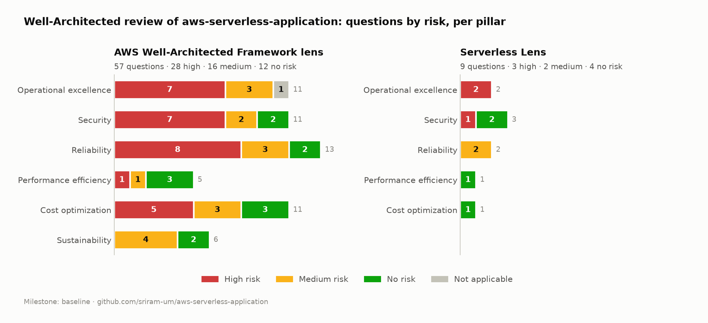

# Well-Architected review — results

What the review of [aws-serverless-application](https://github.com/sriram-um/aws-serverless-application)
found, using the process in [How to do a review](01-how-to-do-a-review.md).

| | |
|---|---|
| **Workload** | `aws-serverless-application`: Orders API (API Gateway, Lambda, DynamoDB global table, Cognito, WAF, optional DAX), AWS SAM, GitHub Actions |
| **Lenses** | AWS Well-Architected Framework (2025-02-25) · Serverless Lens (2020-02-04) |
| **Reviewed** | 2026-10-24, against `main` @ `a25f479`, plus read-only checks of the AWS account |
| **Milestone** | `v1.0-baseline` (#1) |
| **Evidence** | Every answer, with file/line evidence or the gap: [`answers/wellarchitected.json`](answers/wellarchitected.json), [`answers/serverless.json`](answers/serverless.json) |
| **Official reports** | PDF reports from the tool are generated with `scripts/wa_review.py report` and kept local — they contain the private account findings. Published: [risk counts](reports/baseline-status.txt) and [per-question risks](reports/baseline-risks.json) |

## 1. Summary

| Lens | Questions | High | Medium | No risk | Not applicable |
|---|---|---|---|---|---|
| Framework | 57 | **28** | 16 | 12 | 1 |
| Serverless Lens | 9 | **3** | 2 | 4 | 0 |

| Pillar (Framework) | High | Medium | No risk | N/A |
|---|---|---|---|---|
| Operational excellence | 7 | 3 | 0 | 1 |
| Security | 7 | 2 | 2 | 0 |
| Reliability | 8 | 3 | 2 | 0 |
| Performance efficiency | 1 | 1 | 3 | 0 |
| Cost optimization | 5 | 3 | 3 | 0 |
| Sustainability | 0 | 4 | 2 | 0 |

**In one sentence:** the application itself is well built — data protection, compute sizing, API
access control, cost-aware design and serverless performance have no risk — but almost nothing
*around* it is in place yet: no alerts, account-level security controls to strengthen, no budget,
no safe deployment strategy, and recovery that has never been tested.

## 2. What the review confirmed is done well

These questions came back with **no risk**. Each is backed by evidence in the answers files.

| Question | Why it has no risk |
|---|---|
| SEC — protect data at rest | KMS encryption on the global table in both regions, SSE on OrderStats, the DLQ, DAX and the API cache — all declared in the template |
| SEC — protect data in transit | HTTPS-only API, TLS to DAX, SigV4 for every AWS call, Cognito JWTs |
| Serverless SEC — control access to the API | Cognito authorizer is the default for every route; ownership enforced from the token's `sub`; analytics limited to the `admins` group |
| Serverless SEC — security boundaries | Four single-purpose functions, each with its own role scoped to one table; GitHub OIDC instead of stored keys |
| PERF — architecture selection, compute, data management | arm64; memory chosen with Power Tuning (512 MB, 38% faster than 256 MB); key-value access and pre-computed aggregates instead of scans; measured DAX, direct integration and replication latency |
| Serverless PERF / COST | Init optimised and measured; direct API Gateway → DynamoDB integration for reads; 14-day log retention; stream filter so non-`INSERT` events never invoke Lambda |
| REL — service architecture, network topology | Small domain-focused functions; OpenAPI contract for every route; DAX VPC planned across two AZs |
| COST — decommissioning, demand, cost of effort | `teardown.sh` removes everything billable and proves it; throttling and batching; everything scripted |
| SUS — software, hardware | Graviton, pay-per-request managed services, components with no use switched off |

## 3. What the review found

The 31 high risk issues (28 + 3) fall into six themes.

### A. Nothing alerts anyone (7 HRIs)
*OPS observability · OPS workload observability · OPS event response · OPS ready to support ·
REL monitor resources · REL withstand component failures · Serverless OPS health*

There is a good CloudWatch dashboard, X-Ray tracing and structured logs — but **not one
CloudWatch alarm** in the template. Lambda errors, API 5XX responses, throttles, messages in the
dead-letter queue and stream lag are visible only to someone who happens to open the dashboard.
API Gateway access logs are off, there are no KPIs/SLOs, and there's no playbook for "what do I do
when X happens".

### B. The AWS account's security baseline needs work (4 HRIs)
*SEC securely operate · SEC identities · SEC detect and investigate events · SEC incident response*

These came from read-only checks of the account (identity, logging and threat-detection
settings), not from the repository. The specific results are **kept private on purpose** — a
public list of an account's missing controls is a map for an attacker. What can be said: the most
important findings of the whole review were here, about access to the account itself rather than
the app, and they are first in the improvement plan. In addition, the app has no API Gateway
access logs or WAF logs and no incident response plan, and the account is a single account shared
by several projects.

### C. Changes go straight to production (5 HRIs)
*OPS mitigate deployment risks · Serverless OPS lifecycle management · SEC application security ·
SEC protect compute · Serverless SEC application security*

Tests and lint gate every deploy, but there is one environment (`prod`) in one account, every
deploy shifts 100% of traffic at once (no Lambda aliases / canary), a failed smoke test doesn't
roll back, and dependencies are never scanned (no Dependabot, no Amazon Inspector).

### D. Cost is designed well but not governed (5 HRIs)
*COST cloud financial management · COST govern usage · COST monitor usage · COST pricing models ·
COST data transfer*

The design is cost-aware (toggles, teardown, estimate per scenario), but there is **no AWS Budget
or cost anomaly alert** in the account, the `project` tag is not confirmed as a cost allocation
tag, and pricing models and data transfer weren't analysed.

### E. Resilience is built in but not tested (6 HRIs)
*REL mitigate interaction failure · REL service quotas · REL back up data · REL fault isolation ·
REL test reliability · REL plan for DR*

What exists: global table with < 1 s RPO, PITR, a scripted rebuild proven in 4 m 38 s. What's
missing: boto3 timeouts are longer than the function timeout, GetOrder has no fallback when DAX
is down, no reserved concurrency (one route can starve the others), OrderStats has no backup or
rebuild script, a PITR restore has never been tested, there is no RTO, and nothing was ever load
tested.

### F. Things a team would have written down (4 HRIs)
*OPS priorities · OPS organization · PERF process · SEC data classification*

No threat model, no performance KPIs or load test, no data classification. Partly expected for a
one-person project — but a threat model and a one-page data classification are cheap and useful.

### Medium risks worth knowing
- **`POST /orders` is not idempotent** — a client retry after a timeout creates a second order,
  and order lines are written with `batch_writer` (not a transaction), so a failure mid-way can
  leave a partial order (REL prevent interaction failure, Serverless REL resiliency).
- **WAF has only a rate-based rule** — no AWS managed rule groups (SEC network protection).
- **The CloudFormation execution role has `AdministratorAccess`** (assumable only by
  CloudFormation), with no permission guardrails (SEC permissions).
- No API usage plans / per-client quotas (Serverless REL inbound request rates).

## 4. What a generic checklist predicted vs. what the review found

Before the review, a generic "serverless Well-Architected" checklist predicted three issues. None
of them was real for this repo:

| Predicted | Reality (evidence) |
|---|---|
| x86 Lambdas at the default 128 MB | arm64 everywhere; 512 MB chosen with Power Tuning ([`template.yaml`](../template.yaml#L33-L38)) |
| Logs that never expire | Explicit log groups with 14-day retention for every function |
| Wildcard IAM, no DLQ on async work | One table per role via SAM policy templates; stream consumer has retries, bisect and an SQS on-failure destination ([`template.yaml`](../template.yaml#L610-L656)) |

…and it missed what actually matters: no alerts, gaps in the account's own security settings, no
budget. **Answer from the evidence, not from a checklist.**

## 5. Improvement plan

Ordered by risk removed per unit of effort and cost. Costs are estimates for this account's
traffic; "expected" means the HRI should drop once the change is in place and the answer updated —
it will be measured in the next milestone, not assumed.

| # | Change | Where | Effort | Running cost | Expected to address |
|---|---|---|---|---|---|
| 1 | **Account security baseline** — the private findings from theme B (identity, logging and threat-detection settings) | Account | ~1 h | $0 to a few $/month | B (all 4), permissions |
| 2 | **AWS Budget** (e.g. $10/month, email at 80% and 100% forecast) + cost anomaly monitor; activate `project` as a cost allocation tag | Account | 15 min | $0 | D (financial management, govern, monitor) |
| 3 | **CloudWatch alarms → SNS email**: Lambda `Errors` and `Throttles` per function, API `5XXError`, DLQ `ApproximateNumberOfMessagesVisible > 0`, aggregator `IteratorAge` | `template.yaml` | 2 h | ~$0.10 per alarm/month (≈ $1) | A (all 7) |
| 4 | **API Gateway access logs** (JSON, 14 days); boto3 `connect/read_timeout` below the function timeout | `template.yaml`, `src/` | 1 h | cents | A, E (mitigate interaction failure) |
| 5 | **Idempotent `POST /orders`** (`Idempotency-Key` header + Powertools idempotency table) and `TransactWriteItems` for the order lines | `src/create_order`, `template.yaml` | ½ day | on-demand table, cents | REL prevent interaction failure, Serverless REL resiliency |
| 6 | **Safe deployments**: `AutoPublishAlias` + `DeploymentPreference: Canary10Percent5Minutes` with the alarms from #3 as rollback triggers; **Dependabot** for pip and GitHub Actions | `template.yaml`, `.github/` | ½ day | $0 | C (deployment risks, lifecycle, app security, protect compute) |
| 7 | **Reserved concurrency** per function; DAX failure → fall back to DynamoDB | `template.yaml`, `src/get_order` | 2 h | $0 | E (fault isolation, mitigate interaction failure), Serverless REL inbound rates |
| 8 | **Backups and recovery**: PITR on OrderStats (or a rebuild-from-Orders script), a PITR restore drill, a written RTO, `DeletionProtectionEnabled` on both tables | `template.yaml`, `scripts/`, README | ½ day | PITR: cents | E (back up data, plan for DR, test reliability) |
| 9 | **WAF managed rule groups** (Core rule set, Known bad inputs, IP reputation); optional Cognito TOTP MFA | `template.yaml` | 1 h | $1 per rule group/month (≈ $3) | SEC network protection |
| 10 | One-page **threat model** and **data classification**; performance KPIs and a small load test | `docs/` | ½ day | load test: cents | F |

### Accepted risks (deliberately not fixed)

| Risk | Why it's accepted |
|---|---|
| Single AWS account, no Organization | Portfolio account; multi-account is the production answer and is noted as such |
| API tier only in us-east-1 (data is multi-region) | Region failover of the API needs a second Cognito pool and Route 53 failover — documented future work (README exercise 11) |
| No chaos engineering / game days / support plan | Out of proportion for a demo workload |
| Single-node DAX | Only deployed for demos (`EnableCaching=false` by default) |
| Organizational culture questions | Not applicable to a one-person project (marked N/A with a reason) |

## 6. What I learned about the process

1. **The tool doesn't look at anything.** It never scans your account or code — every answer
   comes from you. The real work is collecting evidence; the tool turns it into a risk view and a
   report.
2. **The most serious findings weren't in the repository.** They came from a handful of
   read-only CLI calls against the account. A code-only review would have missed them.
3. **Decide what to publish.** Findings about the account's own security settings stay private;
   the public write-up names the theme, not the specific gaps.
4. **A first review shows lots of high risks — that's normal.** The Framework is written for
   organizations running production systems. A question is high risk when an *important* best
   practice is missing, even if most of the others are in place: "mitigate interaction failure"
   has 4 of 7 practices and is still high risk (no timeouts below the function timeout, no
   graceful degradation). The count matters less than the prioritised list it produces.
5. **"Not applicable" is a precise tool.** Marking 18 *choices* that can't exist here (VPN to
   on-premises, load balancers, accelerators…) as not applicable, each with a reason, moved
   high risks from 30 to 28. Using it for real gaps ("we have no budget") would just hide risk.
6. **Answers as code pay off.** 66 answers in two JSON files can be reviewed in a pull request,
   re-applied in seconds, and diffed between milestones. The tool's console stays the place to
   *read* the review.
7. **CLI gotchas:** list commands return 10 items by default and the CLI doesn't page through this
   service automatically (47 of 57 questions silently missing); boto3 has no paginators for it;
   the PDF report arrives base64-encoded and needs whitespace stripped on Windows.

## 7. Next step

Work through the improvement plan in small pull requests. After each one, update the affected
answers in `answers/*.json`, run `scripts/wa_review.py apply`, and when a group is done save a new
milestone (`v1.1-…`) and regenerate the chart with `scripts/risk_chart.py` to compare against this
baseline.
